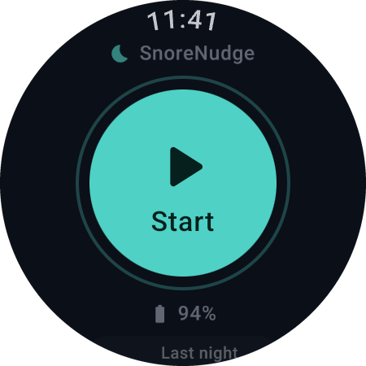
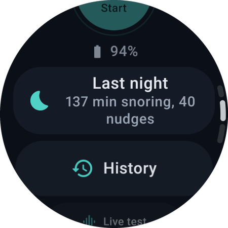
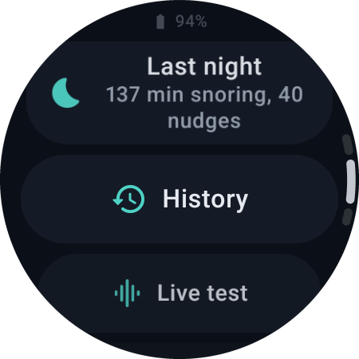

# SnoreNudge

**A Wear OS app that hears you snore and gently taps your wrist, so you roll over before you wake anyone up.**

SnoreNudge runs entirely on the watch. It listens through the watch's own microphone, recognises snoring with an on-device neural network, and vibrates when snoring keeps going. No phone app, no cloud, no account, and no audio is ever stored or sent anywhere. The app does not even request internet access.

Built for and tested on the **Samsung Galaxy Watch4 Classic** (Wear OS, Android 14). It works with a watch paired to an iPhone, or with no phone at all.

<p align="center">
  
  &nbsp;
  
  &nbsp;
  
</p>
<p align="center"><sub>Running on a Galaxy Watch4 Classic (46 mm). Screenshots captured over adb.</sub></p>

---

## Why

Most snore apps live on the phone: the phone records the room, and the "stop snoring" vibration happens on the nightstand where nobody feels it. Apple Watch apps can tap your wrist, but Galaxy Watch owners on iPhone have no equivalent.

SnoreNudge moves the whole thing to the wrist. The microphone sits a few centimetres from the snorer, the detection runs locally, and the nudge goes exactly where it is needed.

## How it works

```
Microphone (16 kHz mono)
  -> energy gate          only wakes the model when the room gets louder than its noise floor
  -> YAMNet (LiteRT)      521-class audio classifier, "Snoring" is one of them, ~45 ms per second of audio on Watch4
  -> frame filter         snoring must beat speech, baby sounds, laughter and coughs, and be loud enough
  -> event builder        merges frames into one snore per breath
  -> episode detector     3 snores within 60 s = an episode
  -> vibration            firm tap, longer and stronger if snoring continues, again 30 s later
```

- **Snoring, not just noise.** Detection uses Google's [YAMNet](https://www.kaggle.com/models/google/yamnet) audio classifier, running on-device through LiteRT (formerly TensorFlow Lite).
- **Partner and baby friendly.** A frame only counts if the snoring score clearly beats speech, child speech, babbling, baby crying, laughter and coughing, and if it is at least 10 dB above the room's noise floor. That favours the person wearing the watch over someone across the room.
- **Patient.** Nothing happens in the first 20 minutes, so you can fall asleep. One snore is ignored; three in a minute triggers a nudge.
- **Persistent, not frantic.** The first nudge is a firm triple tap. If you start snoring again within 5 minutes it switches to a longer, stronger pattern (about 3 s). After each nudge it waits 30 s before it can nudge again, and there is a configurable nightly cap.
- **Works in Bedtime mode.** Vibrations are sent directly by the app with alarm usage, not as notifications, so Do Not Disturb and Bedtime mode do not swallow them.
- **Battery aware.** The model only runs when the energy gate is open. The session stops automatically at 07:30, after 10 hours, or when the battery drops to 10% (unless charging).

## Features

- One-tap Start / Stop, with elapsed time, snore count and nudge count
- **Live test** screen: live level meter, noise floor, snoring score, top label and inference time, plus test buttons for each vibration level
- **Test mode** for daytime testing (no start delay), switches itself off after one session
- **History** of the last 30 nights: snoring minutes and nudges per night, with a 30-day chart
- **Night detail**: a timeline in 10-minute steps with every nudge marked by level, plus stats for the night
- **Settings**: sensitivity, cooldown, start delay, snores needed, auto-stop time, vibration strength, nightly cap
- **Tile** to start or stop a session straight from the watch face carousel
- Night log as CSV in app-private storage, for tuning thresholds
- Round-screen UI built with Compose for Wear OS, rotating-bezel scrolling, dark only

## Privacy

- Audio is processed in memory, one second at a time, and discarded.
- No recordings are saved. The night log stores only numbers: timestamps, scores and levels.
- No `INTERNET` permission, no analytics, no accounts.

## Requirements

- A Wear OS watch with a microphone, Wear OS 3 or newer (minSdk 30)
- Tested on Galaxy Watch4 Classic (SM-R895F), Android 14 / Wear OS 5, 32-bit ARM
- To build: JDK 17+ and the Android SDK (platform 36). Android Studio is optional.

## Install on your watch

No Play Store listing (yet). Install it once over Wi-Fi with adb, and it stays installed.

1. On the watch: **Settings > About watch > Software information**, tap **Software version** about 7 times to unlock Developer options.
2. **Settings > Developer options**: turn on **ADB debugging** and **Wireless debugging**. Keep the watch and computer on the same Wi-Fi.
3. In **Wireless debugging > Pair new device**, note the IP:port and the 6-digit code, then on your computer:

   ```bash
   adb pair <ip>:<pairing-port> <code>
   adb connect <ip>:<port>        # the port shown on the main Wireless debugging screen
   adb devices                    # the watch should be listed
   ```

4. Build and install:

   ```bash
   ./gradlew :app:installDebug
   ```

5. Turn Wireless debugging off again when you are done (battery and security).

On first launch, grant microphone and notification access and allow the app to run unrestricted in the battery settings.

## Using it

1. Before sleep, open SnoreNudge and tap **Start**. Turn the screen off and keep the watch on your wrist.
2. The first 20 minutes are silent. After that, sustained snoring triggers a vibration.
3. In the morning it stops by itself at 07:30, or tap **Stop**.

To check that detection works in your room, open **Live test**, enable **Test mode**, start a session and play a snoring video from a phone about 30 cm from the watch.

## Reading the night log

On a debug build:

```bash
adb shell run-as ro.goldenlobster.snorenudge ls files/nights
adb shell run-as ro.goldenlobster.snorenudge cat files/nights/<file>.csv > night.csv
```

Columns: `ts,type,snore,competitor,top,topScore,peakDb,floorDb,level,note`. Row types are `frame`, `event`, `nudge`, `suppressed`, `summary`, `start` and `stop`.

## Tuning

Most of these can be changed on the watch in **Settings**. The defaults live in [`DetectionConfig`](app/src/main/java/ro/goldenlobster/snorenudge/detect/DetectionConfig.kt):

| Setting | Default | Meaning |
|---|---|---|
| `scoreThreshold` | 0.30 | Minimum YAMNet "Snoring" score for a frame |
| `dominanceMargin` | 0.05 | Snoring must beat speech/baby/laughter/cough by this much |
| `minSnoreDbAboveFloor` | 10 dB | Loudness above the room's noise floor |
| `eventsToTrigger` / `episodeWindowMs` | 3 / 60 s | Snores needed to count as an episode |
| `cooldownMs` | 30 s | Quiet time after a nudge |
| `startDelayMs` | 20 min | Time to fall asleep before any nudge |
| `maxNudgesPerNight` | 150 | Safety cap (or unlimited) |

## Project structure

```
app/src/main/java/ro/goldenlobster/snorenudge/
  audio/     microphone capture, ring buffer, 48k->16k resampler, energy gate, dB meter
  ml/        YAMNet classifier (LiteRT) and class map
  detect/    frame filter, event builder, episode detector (pure Kotlin, unit tested)
  haptics/   vibration patterns and controller
  data/      Room database (nights, snore events, nudges), settings (DataStore), aggregations
  service/   foreground service, wake lock, ongoing activity, night log
  tile/      Start/Stop tile
  ui/        Home, Live test, Setup, History, Night detail, Settings (Compose for Wear OS)
```

The detection logic is plain Kotlin with injected clocks and is covered by JVM unit tests:

```bash
./gradlew :app:testDebugUnitTest
```

[`CLAUDE.md`](CLAUDE.md) holds the full technical spec, decisions and status.

## Roadmap

- [x] Microphone service that survives the night with the screen off
- [x] On-device snoring detection with YAMNet
- [x] Nudging with escalation, cooldown and start delay
- [x] Night history: last 30 nights and a detailed timeline of each night
- [x] Settings screen (sensitivity, cooldown, start delay, stop time, vibration strength)
- [x] Start/Stop tile
- [ ] Threshold tuning from real nights

## Credits

- [YAMNet](https://github.com/tensorflow/models/tree/master/research/audioset/yamnet) by Google, trained on [AudioSet](https://research.google.com/audioset/). The model (`yamnet.tflite`) and class map are redistributed under the Apache License 2.0.
- [LiteRT](https://ai.google.dev/edge/litert) for on-device inference.
- Built by [Golden Lobster Studio](https://goldenlobster.ro), with Claude.

## Disclaimer

SnoreNudge is a comfort tool, not a medical device. It does not diagnose or treat sleep apnea or any other condition. Loud, frequent snoring, gasping or choking at night can be signs of sleep apnea; talk to a doctor about it.

## License

[MIT](LICENSE) for the app's source code. The bundled YAMNet model and class map remain under the Apache License 2.0.
